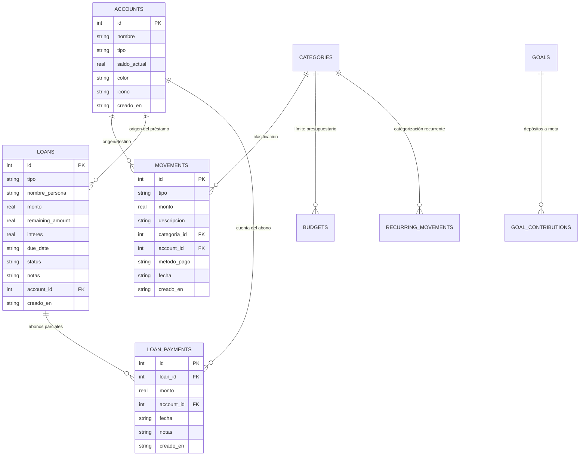

# Arquitectura y Estructura del Proyecto

## 1. Patrón Arquitectónico Global

La aplicación está construida sobre una arquitectura **Feature-First (Modular por características) + MVVM (Model-View-ViewModel) + Inyección de Dependencias (GetIt)** impulsada por **Provider** para la reactividad de la interfaz.

```
                  ┌─────────────────────────────────────────┐
                  │             UI (Widgets/Pages)          │
                  │  Consume ViewModel vía context.watch    │
                  └────────────────────┬────────────────────┘
                                       │ Notificaciones (notifyListeners)
                                       ▼
                  ┌─────────────────────────────────────────┐
                  │          ViewModel (ChangeNotifier)     │
                  │   Maneja estado, lógica y reactividad   │
                  └────────────────────┬────────────────────┘
                                       │ Llama a repositorios
                                       ▼
                  ┌─────────────────────────────────────────┐
                  │           Repository Layer              │
                  │  Abstracción de acceso a datos / caché  │
                  └────────────────────┬────────────────────┘
                                       │ Invoca DAOs
                                       ▼
                  ┌─────────────────────────────────────────┐
                  │            DAO (Data Access)            │
                  │ Operaciones CRUD y deltas contables SQL │
                  └────────────────────┬────────────────────┘
                                       │ Consultas directas
                                       ▼
                  ┌─────────────────────────────────────────┐
                  │        DatabaseHelper (SQLite)          │
                  │    Base de datos local finanzas_v4.db   │
                  └─────────────────────────────────────────┘
```

---

## 2. Mapa Detallado del Directorio `lib/`

```
lib/
├── main.dart                               # Punto de entrada de la aplicación, inicialización de DI y Tema
│
├── core/                                   # Núcleo transversal a toda la aplicación
│   ├── constants/
│   │   ├── app_colors.dart                 # Paleta Slate & Indigo, radios estándar (16px) y colores de estado
│   │   ├── app_icons.dart                  # Constantes iconográficas
│   │   └── app_texts.dart                  # Textos y literales estáticos
│   ├── di/
│   │   └── locator.dart                    # Inyección de dependencias con GetIt (registro de repositorios)
│   ├── providers/
│   │   ├── privacy_provider.dart           # Estado reactivo para ocultar montos confidenciales (Modo Ojo)
│   │   └── theme_provider.dart             # Gestión de cambio de modo Claro / Oscuro
│   ├── providers.dart                      # MultiProvider con todos los ViewModels globales
│   ├── routes/
│   │   └── app_router.dart                 # Configuración centralizada de GoRouter y rutas nombradas
│   ├── theme/
│   │   └── app_theme.dart                  # Definición ThemeData (Material 3, GoogleFonts Outfit, CardTheme)
│   └── utils/
│       ├── currency_formatter.dart         # Formateador de moneda boliviana (Bs.) y números decimales
│       └── date_formatter.dart             # Formateo amigable de fechas y rangos temporales
│
├── data/                                   # Capa de infraestructura y persistencia base
│   ├── database/
│   │   └── database_helper.dart            # Singleton SQLite con migraciones y semillas iniciales
│   ├── firebase/                           # Conexión opcional a servicios de respaldo en la nube
│   ├── models/                             # Modelos base compartidos
│   └── repositories/                       # Implementaciones concretas de repositorios
│
├── features/                               # Módulos funcionales encapsulados por dominio
│   │
│   ├── configuracion/                      # Preferencias de usuario, exportación y tema
│   │   └── ui/
│   │       ├── configuracion_page.dart     # Pantalla de ajustes, moneda, respaldo y seguridad
│   │       └── exportar_datos_page.dart    # Exportación a formato CSV / PDF
│   │
│   ├── cuentas/                            # Gestión de entidades bancarias, efectivo y billeteras móviles
│   │   ├── data/
│   │   │   ├── cuenta_model.dart           # Modelo Cuenta (id, nombre, tipo, saldoActual, color, icono)
│   │   │   ├── cuenta_dao.dart             # Operaciones CRUD y ajuste delta de saldos en tabla accounts
│   │   │   └── cuenta_repository.dart      # Repositorio mediador
│   │   ├── ui/
│   │   │   └── crear_cuenta_modal.dart     # Modal con paleta de 14 colores y edición completa
│   │   └── viewmodel/
│   │       └── cuenta_viewmodel.dart       # Estado de cuentas y cálculo del Saldo Total Unificado
│   │
│   ├── inicio/                             # Dashboard principal y resumen diario
│   │   └── ui/
│   │       ├── inicio_page.dart            # Hero card, métricas mensuales, cuentas horizontales y lista
│   │       └── widgets/
│   │           └── captura_rapida_widget.dart # Tarjeta de ingreso/gasto inmediato en 1 toque
│   │
│   ├── metas/                              # Objetivos de ahorro y avances
│   │   ├── data/                           # MetaModel y MetaDao (tabla goals, goal_contributions)
│   │   ├── ui/                             # Vistas de listado, registro y aportes a metas
│   │   └── viewmodel/                      # MetaViewModel con porcentaje de progreso calculado
│   │
│   ├── movimientos/                        # Historial y registro de ingresos y gastos
│   │   ├── data/
│   │   │   ├── movimiento_model.dart       # Entidad Movimiento con account_id y categoría
│   │   │   ├── movimiento_dao.dart         # Inserción con ajuste delta automático en la cuenta asociada
│   │   │   └── movimiento_repository.dart  # Acceso a datos de transacciones
│   │   ├── ui/
│   │   │   ├── movimientos_page.dart       # Vista de historial con filtros por tipo y búsqueda
│   │   │   └── registrar_movimiento_page.dart # Formulario completo con selector de categorías y fechas
│   │   └── viewmodel/
│   │       └── movimiento_viewmodel.dart   # Cálculos totales históricos y mensuales (mes actual)
│   │
│   ├── prestamos/                          # Control de deudas prestadas y recibidas
│   │   ├── data/
│   │   │   ├── prestamo_model.dart         # Entidad Préstamo (tipo prestado/recibido, remaining_amount)
│   │   │   ├── devolucion_model.dart       # Historial de abonos/devoluciones parciales
│   │   │   └── prestamo_dao.dart           # Reconciliación contable y reversión de deltas al eliminar
│   │   ├── ui/
│   │   │   ├── prestamos_page.dart         # Listado dividido en 'Me Deben' y 'Debo'
│   │   │   ├── detalle_prestamo_page.dart  # Vista de progreso, historial de pagos y amortización
│   │   │   ├── registrar_prestamo_page.dart # Creación de préstamo con impacto opcional en cuenta
│   │   │   └── registrar_devolucion_modal.dart # Registro de abono con amortización directa
│   │   └── viewmodel/
│   │       └── prestamo_viewmodel.dart     # Cálculos de totalMeDeben y totalDebo
│   │
│   ├── presupuestos/                       # Límites de gasto por categoría
│   │   ├── data/                           # BudgetModel y BudgetDao (tabla budgets)
│   │   ├── ui/                             # Progreso visual con barras de consumo porcentual
│   │   └── viewmodel/                      # BudgetViewModel
│   │
│   ├── recurrentes/                        # Gastos e ingresos automáticos periódicos
│   │   ├── services/
│   │   │   └── recurrente_executor.dart    # Motor de ejecución diferida según fecha/día programado
│   │   └── ui/                             # Configuración de transacciones fijas (alquiler, suscripciones)
│   │
│   ├── reportes/                           # Gráficos estadísticos y análisis financiero
│   │   └── ui/
│   │       └── reportes_page.dart          # Gráficos con fl_chart (torta de categorías, balance semanal)
│   │
│   ├── seguridad/                          # Bloqueo por PIN de seguridad
│   │   └── ui/
│   │       ├── numeric_keypad.dart         # Teclado numérico táctil personalizado
│   │       └── pin_screen.dart             # Validación de PIN al abrir la app o desbloquear
│   │
│   ├── setup/                              # Wizard de bienvenida para usuarios nuevos
│   │   └── ui/                             # Pasos de configuración inicial (moneda, saldos iniciales, PIN)
│   │
│   └── shell/                              # Cascarón de navegación Material 3
│       └── ui/
│           ├── main_shell.dart             # NavigationBar unificado con 4 pestañas y FAB central '+'
│           └── mas_page.dart               # Menú secundario hacia Metas, Presupuestos, Recurrentes y Reportes
│
└── shared/                                 # Componentes y servicios reutilizables
    ├── components/
    │   └── accion_rapida_sheet.dart        # Menú contextual desplegable del botón '+' central
    └── services/
        └── export_service.dart             # Generación de archivos CSV y reportes en PDF
```

---

## 3. Esquema Relacional de Base de Datos (SQLite)


